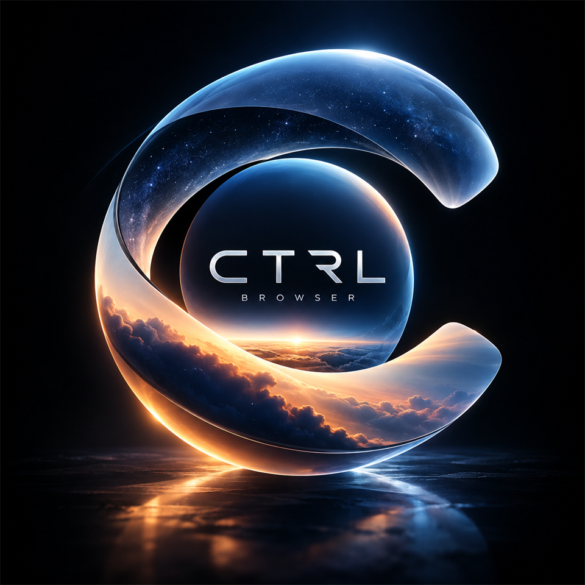

# CTRL Browser

  

CTRL Browser is a local-first desktop browser for Windows. Bookmarks, history, notes, and preferences stay on this device.

**[Download CTRL Browser for Windows](https://github.com/shahil5z/ctrl-browser-releases/releases/latest/download/CTRLBrowser-setup.exe)**

## Download

Download the latest Windows release from [GitHub Releases](https://github.com/shahil5z/ctrl-browser-releases/releases/latest).

## Installation

1. Download the Windows installer.
2. Run the installer.
3. Launch CTRL Browser.

## Website

[ctrl-browser.vercel.app](https://ctrl-browser.vercel.app)

## License

CTRL Browser is proprietary software.  
See the [LICENSE](LICENSE) file for details.
